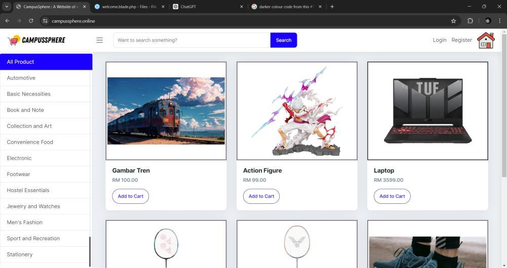
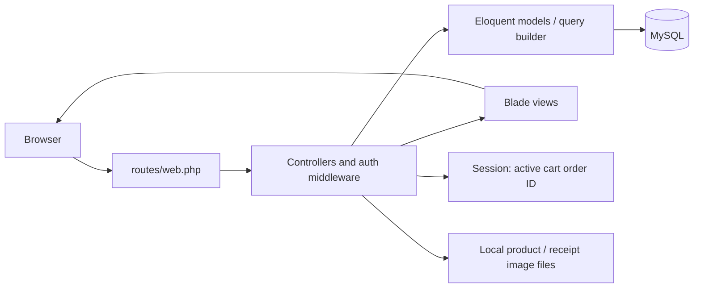

# CampusSphere

**A campus e-marketplace for UiTM Arau | Completed Academic Project**

CampusSphere is a Laravel and MySQL web application developed by Afiq Haikal Mohd Asri as a Final Year Project in Netcentric Computing at Universiti Teknologi MARA (UiTM). It brings product listings, shopping carts, order records and manual proof-of-payment handling into a campus-focused application.

> This project was developed as an academic Final Year Project and is no longer actively maintained.

The July 2024 thesis documents the original application and evaluation. This repository is preserved as academic work; it is not presented as a production-ready service.



[Features](#features) · [Architecture](#architecture) · [Local setup](docs/LOCAL_SETUP.md) · [Screenshots](docs/SCREENSHOTS.md) · [Known limitations](#known-limitations)

## Problem statement and objectives

The thesis identifies the lack of a dedicated marketplace for the UiTM Arau community, alongside students' transport constraints and academic schedules, as the motivation for the project.

The original objectives were to:

1. Design and develop a campus e-marketplace website.
2. Evaluate its functionality and usability through User Acceptance Testing (UAT) and network testing focused on response time and throughput.

## Features

The following workflows have routes, controllers and views in the current source. Their presence does not establish production readiness or replace runtime testing.

| Area | Implemented in the source |
|---|---|
| Accounts | Registration, login, logout, password hashing and profile-name updates |
| Catalogue | Product listings, name search and category filtering |
| Products | Seller-filtered product list; create, update and delete operations; product-image upload |
| Shopping cart | Add items, change quantities, remove items and leave the cart through checkout |
| Orders | Buyer and seller order lists, order details and an invoice view |
| Payments | Upload an image as proof of an external payment; accept/reject actions and order-status changes |
| Administration | Category management and a user-list view |
| Seller dashboard | Counts of orders by status and a sales summary |

Payments happen outside the application. There is no implemented payment-gateway checkout.

### Users and roles

The database seeds **User** and **Admin** roles. Buying and selling are workflows available to user accounts, rather than separate seeded Buyer and Seller roles.

The navigation shows category/user administration for `role_id == 2`. The payment view shows approval controls to the order's seller. These interface conditions are not a complete server-side authorization system; see the limitations below.

## Technology stack

| Layer | Repository evidence |
|---|---|
| Backend | PHP and Laravel **8.83.27**, recorded in `composer.lock` |
| Views | Blade templates, JavaScript and bundled template CSS/JS |
| Database | MySQL connection configured by default |
| Asset tooling | Laravel Mix **6.0.49**; Bootstrap **5.3.3** in `package-lock.json` |
| Authentication | Laravel's session-based `web` guard and custom login/registration controller |
| Data access | Eloquent models and Laravel's query builder |
| Testing scaffold | PHPUnit **9.6.19** and the default example tests |

The bundled template assets are separate from the npm-managed Bootstrap dependency. The frontend should not be described as a React application or a marketplace REST API.

## Architecture

The application uses Laravel MVC with server-rendered views. Most catalogue, order and payment behavior is implemented directly in controllers.



Cart items are stored in `orders` and `order_product`; the session holds the active order ID. Upload code uses the public filesystem disk and also moves files into `public/uploads` or `public/payments`.

`routes/api.php` contains the scaffold authenticated `/api/user` route. A Telegram notification class exists, but no invocation was found in the reviewed application code, so working notifications are not claimed.

### Project structure

```text
app/Http/Controllers/  Authentication, catalogue, orders and management
app/Models/            Eloquent models
database/migrations/   Schema definitions
database/seeders/      Roles, categories, statuses and sample records
resources/views/       Blade pages and shared layouts
resources/js/          Bootstrap/Axios setup
routes/web.php         Application routes
public/                Bundled assets and legacy uploaded files
docs/                  Local setup and historical screenshot provenance
```

## Database overview

These are the application tables defined by the committed migrations.

| Table | Purpose |
|---|---|
| `users`, `roles` | Accounts and role lookup |
| `categories` | Product categories |
| `products` | Listing details, seller/category IDs, price and image filename |
| `orders` | Buyer/seller IDs, order number, stored total and order status |
| `order_product` | Order items and quantities |
| `order_payments` | Receipt filename, submitted amount, order ID and payment status |
| `order_status` | New, In Process and Completed |
| `payment_status` | Pending, Approved and Reject |

The schema also includes framework-support tables for sessions, password-reset tokens, cache and jobs. Most application references are integer columns without declared foreign-key constraints. The thesis's historical database screenshot is not an exact migration manifest for this checkout.

## Getting started

Use an isolated local environment with a new, empty database and synthetic accounts.

- The locked PHP dependencies constrain the runtime to **PHP 8.2 or 8.3**: `symfony/css-selector` requires PHP 8.2+, while `nette/utils` excludes PHP 8.4+. The broader PHP range in `composer.json` is not sufficient guidance for installing the lockfile.
- Composer, a MySQL-compatible server and the required PHP extensions are needed.
- Node.js/npm are only needed to rebuild the configured frontend assets.
- Neither `.env` nor `.env.example` is tracked. Create a local `.env` using the example and instructions in [Local setup](docs/LOCAL_SETUP.md).

The setup guide covers dependency installation, environment variables, lookup-table seeding and starting the application:

```bash
composer install
composer check-platform-reqs --lock
php artisan key:generate
php artisan migrate
php artisan serve --host=127.0.0.1 --port=8000
```

Create `.env` and configure the empty database before running these commands. Follow the selective seeding instructions in the guide before registering an account. Do not use the repository's predictable sample login.

Composer metadata and locked platform requirements were checked on PHP 8.3.8 during this documentation review. Application installation, migrations, browser workflows and automated tests were not rerun.

## Screenshots

The images are original application screenshots extracted from the author-provided July 2024 thesis. They show the historical application, not a newly deployed instance.

- Catalogue: Figure 4.6, thesis page 48.
- Login: Figure 4.8, thesis page 50.
- Category management: Figure 4.32, thesis page 65.

See the [screenshot gallery and provenance](docs/SCREENSHOTS.md). No generated UI previews or payment receipts are used as screenshots.

## Academic evaluation

The thesis records manual functionality tests, UAT with **33 participants**, and network/web performance testing. These are historical academic results, not fresh test results for the current checkout. The repository's automated tests remain scaffold examples.

## Known limitations

- Role and record-ownership checks are incomplete. Hiding navigation or buttons does not secure the underlying actions.
- Several state-changing actions use GET requests.
- Stored cart/order totals, multiple-seller carts and receipt-status updates have consistency limitations.
- Receipts are handled manually and stored under public paths with original filenames. GIF, JPG and PNG files up to 2048 KB are accepted by the current validator; PDF uploads are not supported by that code.
- Password-reset/email-verification scaffolding is not connected through the active custom authentication routes.
- Historical revisions retain personal uploads and debug logs. Other legacy uploaded files still require privacy review. Use no real personal or payment data when exploring the application.
- The original environment and a complete historical database backup are not supplied. A clean installation and all workflows remain unverified.

## Academic disclaimer

This project demonstrates academic application development, database modeling and workflow implementation. It is preserved for reference and portfolio review. New features, dependency upgrades and production deployment are outside its current maintenance scope.
