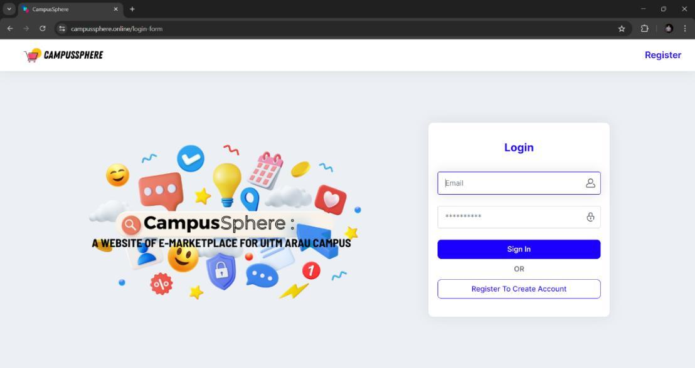
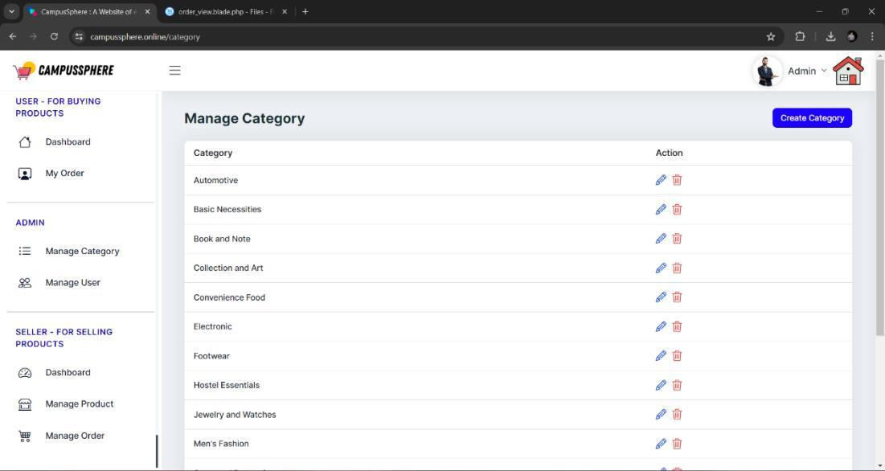

# Historical application screenshots

These are real screenshots extracted from the author's July 2024 thesis, *CampusSphere: A Website of e-Marketplace for UiTM Arau Campus*. They are images of the original application, not design mockups, AI-generated previews or evidence of a current live deployment.

The original embedded image bytes were extracted without retouching or regenerating the interface.

| Image | Thesis figure | Printed page | PDF page |
|---|---|---|---|
| `catalogue.jpg` | 4.6 - Home Page (Before Login) | 48 | 62 |
| `login.jpg` | 4.8 - Login Page | 50 | 64 |
| `categories.jpg` | 4.32 - Manage Category Page | 65 | 79 |

The PDF page is the one-based file page index. The printed page is the number shown in the thesis.

## Public catalogue

## Login

## Category management

This screen shows the historical interface; it is not evidence of complete server-side administrator authorization.

## Privacy and remaining captures

The selected figures do not display the identified receipt, mail-message screenshot or other users' account lists. The full thesis is not included in this repository.

Seller product-management, cart, order/payment and user-list figures exist in the thesis, but some show identifiable account information. They were not selected for publication.

If additional screenshots are prepared later, use synthetic accounts and fictional products. Capture the product editor, cart, seller order list and a fictional receipt-review flow only after checking that names, emails, transaction identifiers and other personal information are absent.

Screenshots may contain the application's historical URL in browser chrome. No current availability of that domain is claimed.
